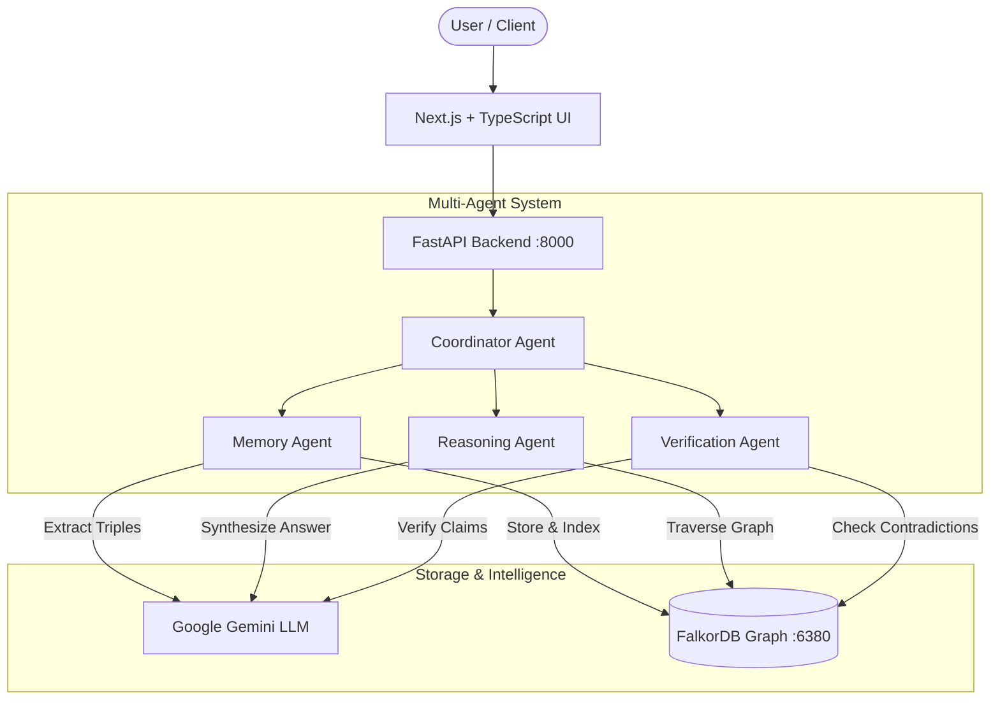

# GraphMind — Persistent Multi-Agent Memory & Decision System

GraphMind is a production-grade multi-agent memory and reasoning platform built for high-reliability decision systems. It converts unstructured natural language into structured knowledge graph representations using **FalkorDB**, provides multi-hop graph reasoning powered by **Google Gemini**, and autonomously verifies all synthesized answers to eliminate hallucinations.

---

## 🌟 Key Features

* **Multi-Agent Orchestration**:
  * **Coordinator Agent**: Dispatches incoming queries, orchestrates subagent pipelines, and aggregates step-level traces.
  * **Memory Agent**: Extracts subject-predicate-object triples with schema validation, generates deterministic IDs, resolves entity duplicates, and tracks superseded facts.
  * **Reasoning Agent**: Conducts multi-hop Cypher queries across entities and relationships, filtering active nodes and extracting direct source evidence.
  * **Verification Agent**: Validates claims and statements against graph ground truth, detecting contradictions, hallucinations, and stale facts.
* **Graph Native Persistence**: Backed by **FalkorDB** for ultra-fast Cypher graph operations with bounded traversal depths and indexed lookups.
* **Grounded Answer Synthesis**: Zero-hallucination answers citing exact fact IDs and source statements.
* **Interactive Frontend**: Modern Next.js dashboard featuring:
  * **Chat & Reasoning Interface**: Multi-step agent traces and verification status indicators.
  * **Memory Intake & Management**: Real-time fact extraction and active memory browser.
  * **Interactive Graph Explorer**: Force-directed Cytoscape.js network visualizer.
  * **Agent Workflow Tracer**: Real-time latency, status, and telemetry per agent.

---

## 🏗️ System Architecture



---

## 🚀 Quickstart Guide

### Prerequisites
* [Docker & Docker Desktop](https://www.docker.com/)
* [Python 3.10+](https://www.python.org/)
* [Node.js 18+](https://nodejs.org/)
* Google Gemini API Key

---

### 1. Clone & Setup FalkorDB
```bash
git clone <your-repository-url>
cd graphmind

# Start FalkorDB container
docker compose up -d
```
FalkorDB will be accessible on `127.0.0.1:6380`.

---

### 2. Backend Setup
```bash
cd backend

# Create and activate virtual environment
python -m venv .venv
.\.venv\Scripts\Activate.ps1   # On Windows
# source .venv/bin/activate    # On Linux/macOS

# Install dependencies
pip install -r requirements.txt

# Configure environment variables
cp .env.example .env
# Edit .env and paste your GEMINI_API_KEY

# Start backend server
python -m uvicorn app.main:app --reload --host 127.0.0.1 --port 8000
```
Backend Swagger API documentation will be available at `http://127.0.0.1:8000/docs`.

---

### 3. Frontend Setup
```bash
cd ../frontend

# Install dependencies
npm install

# Configure environment variables
cp .env.local.example .env.local

# Start development server
npm run dev
```
Open `http://localhost:3000` in your browser.

---

## 🧪 Testing & Validation

### Run Backend Tests (Pytest)
```bash
cd backend
python -m pytest tests/ -v
```
*Current test suite: **61 passed**, 1 skipped.*

### Run Frontend Lint & Type Checks
```bash
cd frontend
npm run lint
npx tsc --noEmit
```

---

## 📡 API Overview

| Method | Endpoint | Description |
| :--- | :--- | :--- |
| `GET` | `/health` | Application health for FalkorDB and Gemini |
| `POST` | `/memory` | Ingest text, extract entity-fact triples, and persist to graph |
| `GET` | `/memory` | Retrieve paginated list of active facts |
| `POST` | `/ask` | Grounded multi-hop question answering with verification |
| `POST` | `/verify` | Standalone verification of claims against graph evidence |
| `GET` | `/graph` | Export graph nodes and edges for visualization |

---

## 🛡️ License
MIT License.
